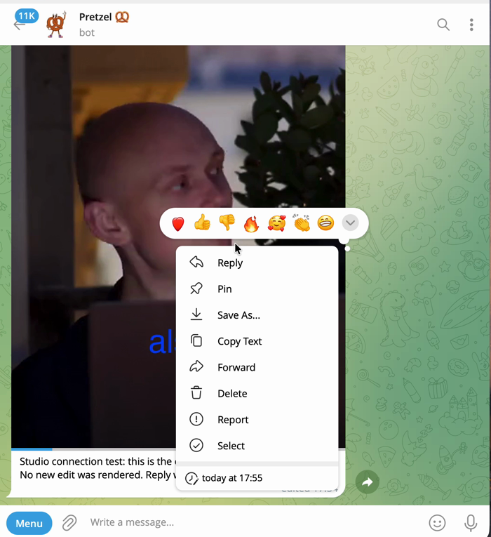
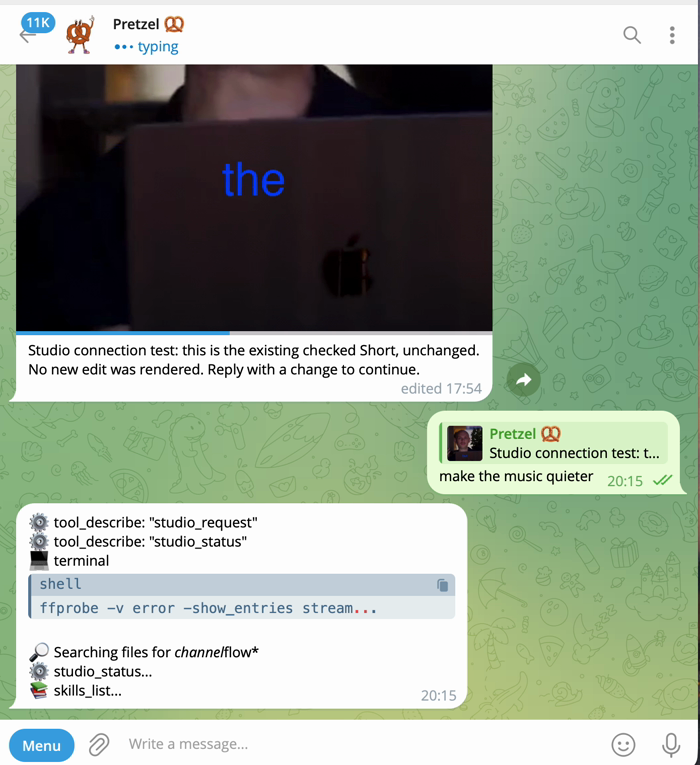
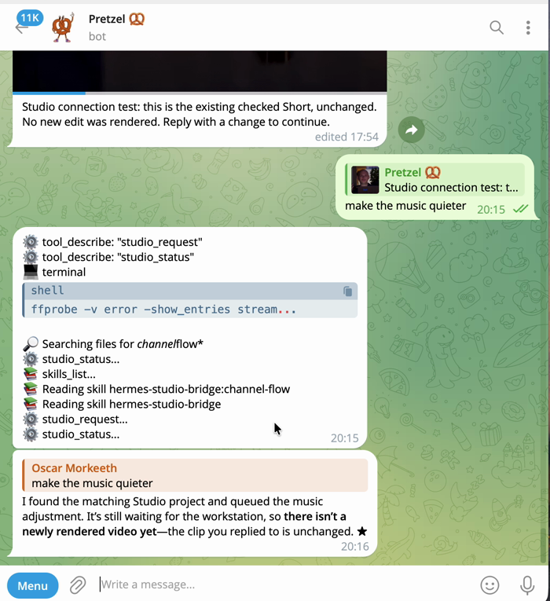
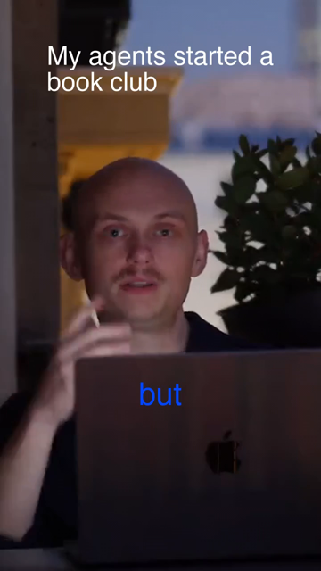

<p align="center"></p>

# Hermes Studio

### Video editing becomes a conversation.

Turn a reviewed local take into an editable vertical short with animated captions and music from your own library. Reply to the delivered preview to change it: Hermes finds the exact project behind that video and makes a new editable revision, which is rendered through an explicit safety gate.

Your footage never leaves your machine. Every version is a real, editable project.

<p align="center">
  
  
  
</p>
<p align="center"><sub>Live, 11 Nov 2026: reply "make the music quieter" to a preview. Hermes finds the matching project and queues a new revision.</sub></p>

## Seen working



- **Reply to edit, live in Telegram (11 Nov 2026).** "Make the music quieter" on a delivered preview resolved the matching project and created a new editable revision with the music at -28 dB. That revision then waits at the render gate; the re-rendered video is not yet delivered automatically.
- **One reviewed take, end to end.** Local transcription, library music, an editable portrait cut with animated captions, and a checked export that passed frame, motion and audio measurements.
- **Local by design.** whisper.cpp on your machine, your own media library, no paid models.

**Today the conversation edit supports music level.** New, unmatched footage returns `needs_reviewed_cut_recipe` instead of guessing a story.

<br clear="right">

## The vision: one studio, every video tool

Every creative tool is getting an agent. None of them talk to each other. Hermes Studio is the conductor: one conversation, one shared timeline, every tool you already love.

You talk. Hermes picks the take, cuts it in your editor, animates it in your motion engine, generates the missing shot with the best model for the job, checks every frame, and hands you back an editable project. You stay the director. Hermes does the crew.

The connector layer is in this release (v0.6.0) as an early foundation. Every connector reports what it really preserves:

| Connector | Status | What survives |
|---|---|---|
| FFmpeg render | ✅ tested | cuts, portrait frame, audio |
| OpenTimelineIO | ✅ tested, read back by the real `opentimelineio` library | one video track of cuts. Captions, music and overlays are ❌ not carried yet |
| Final Cut Pro (FCPXML 1.10) | ❓ file written and checked, not yet opened in Final Cut | cuts only |
| DaVinci Resolve (FCPXML or OTIO) | ❓ not yet opened in Resolve | cuts only |
| Premiere Pro | ❌ next | |
| Higgsfield | ⚠️ dry run: plans a request, never sends, never spends | |
| Motion Canvas, Revideo, Manim | ❌ next | |

The goal is a loss report for every connector: what is preserved, what is flattened, what is not supported. Details: [docs/CONNECTORS.md](docs/CONNECTORS.md).

**Tests:** 40 run, 37 pass and 3 are skipped because they need real media fixtures. The suite is not an end-to-end validation of the Telegram loop.

### Next, in order

1. Close the loop: an authorized revision renders through the gate and the new video comes back in the chat.
2. One more creative edit beyond music level: caption style, a tighter opening, or an animated title.
3. One real generated insert from one real model, approved before any spend.
4. A Studio Doctor command and a sample project with redistributable media, so anyone can reproduce the core flow.

## Install

The full plugin requires Hermes >=0.21.5. The verified composed session used Hermes0.22.7. Install the separately licensed editor, FFmpeg/ffprobe with drawtext/loudnorm/libx264/AAC, and an existing local speech model first. Studio never downloads a model or calls a paid provider.

```sh
hermes plugins install Morkeeth/hermes-studio --enable
hermes plugins install oliverhees/hermes-video-editor --ref 66035165c71e09b7f77a08aecc36e35c0b2dce14 --enable
```

Validate the exact checked-out source and inspect registration before use:

```sh
hermes plugins validate /path/to/hermes-studio
hermes plugins doctor /path/to/hermes-studio --ci
python3 -m unittest discover -s /path/to/hermes-studio -p 'test_*.py' -v
```

Core tools: studio_take, studio_library, studio_build, studio_cut, studio_gate, studio_verify_post, studio_request, studio_status, studio_connectors, studio_timeline, studio_generate. Read [SKILL.md](SKILL.md) for the explicit reviewed-recipe requirements. studio_build accepts recipe, output and render=false by default. A genuine native project template and actual word alignment are required inputs. New footage is not silently given invented timing or story approval.

## Two-host conversation flow

The gateway-only companion in [gateway/](gateway/) requires Hermes >=0.20.0 and exposes only studio_request/studio_status plus the channel-flow skill. Do not install both companions on the same host because their tool names overlap. Use the full plugin on the workstation and the small companion on a gateway. The old gateway runtime does not imply support for the full editor.

Create private gateway configuration at HERMES_HOME/studio-channel/config.json from [GATEWAY.example.json](GATEWAY.example.json). Set real inbound roots and a confirmed allowed recipient. The host launcher supplies the existing single-profile environment; delivery resolves TELEGRAM_BOT_TOKEN only through Hermes agent.secret_scope.get_secret. The plugin never reads a credential file. The token is never copied to the workstation or repo. Enable the gateway companion through the official plugin installer using its repository subdirectory URL, then enable its name. Load hermes-studio-bridge:channel-flow explicitly; plugin skills may be absent from the flat available-skills index.

Create a private workstation config from [WORKER.example.json](WORKER.example.json). The workstation initiates outbound SSH using an existing alias; no public listener or reverse login is required. Point remote_rpc at bridge_rpc.py and use a fresh workspace. Run one bounded pass:

```sh
python3 connector_worker.py --config /private/workstation.json
```

Add --deliver-ready only when sending checked previews to the configured recipient is authorized. No daemon or scheduler is installed automatically. Supply a stable request_key based on the real channel/chat/message for retries. library searches the configured workstation folders; prepare transfers the actual downloaded attachment with hash verification. A configured reviewed project can be reused only for the exact original source. Unmatched footage returns needs_reviewed_cut_recipe.

An explicit music_gain_db edit creates a native project successor, preserves old versions and invalidates the old preview. It waits for the existing render gate; no new encode is launched. Delivery receipts distinguish started/uncertain from Telegram-confirmed sent. Unknown outcomes are not automatically retried. API acceptance does not prove phone playback.

## Boundaries

No paid generation, automatic public publication, arbitrary remote commands, inferred music rights, semantic library retrieval, face tracking or automatic taste certification. No broad editing autonomy is granted by these tools. studio_gate combines measurements with supplied title/caption/no-zoom observations; missing or stale visual review fails. Keep story/look decisions separate. Render authorization, source immutability, external uploads and spending remain host/operator policy.

This is a single-owner template. The queue is not a public multi-user service. Advanced arbitrary reply edits, a complete new-footage judgement loop, continuous worker supervision, additional editor adapters and a generative-model hub remain future work. Editing state is a real native .vproj.json, not chat prose.

## Credits and licenses

Studio code: MIT. The manifest format follows oliverhees/hermes-video-editor/plugin.yaml at the pin above. That separate editor uses PolyForm Noncommercial1.0.0 and is not redistributed; commercial use may require separate permission.

- [whisper.cpp](https://github.com/ggml-org/whisper.cpp) — MIT, local ASR backend.
- [hermes-video-editor](https://github.com/oliverhees/hermes-video-editor) — native editable project and media tools; separate dependency/license.
- [Eyes](https://github.com/Agenziamaia/eyes) — MIT, optional measurements/contact sheet; no semantic approval claim.
- [Hermes Showreel](https://github.com/Duffey234/hermes-showreel) — MIT, optional actual session hooks/planning; narration disabled for unpaid operation.
- [LottieFiles motion-design-skill](https://github.com/LottieFiles/motion-design-skill) — MIT guidance used for demo timing, not a bundled renderer.

No media, models, proprietary fonts, external plugin source, private host configuration, credentials or private repository history are distributed. FFmpeg builds carry their own terms and are not bundled. Prepared for the Hermes Agent Plugin Hackathon; this repository is not evidence of event submission.

For standalone SSH delivery, configure remote_prefix as an operator-owned host launcher that supplies the existing profile environment (for example a systemd transient service with an EnvironmentFile). Hermes secret_scope resolves the token; plugin code never opens a credential store. Keep launcher paths and all real host configuration private. With multiplexing, provide the correct secret scope or fail closed.

## Recipe configuration

Copy RECIPE.example.json to private storage and replace every path/hash with actual local inputs. The reviewed native project must initially reference only the exact original camera take. The alignment file contains the actual words array used for that source (each word includes text and measured start/end anchors). Fresh ASR/hook suggestions are recorded separately; they do not overwrite reviewed timing. Record the real shelf track rights/scope. The build fails when source/template/music hashes differ or no local track matches.

Call studio_build with recipe set to that private JSON, output set to a fresh absent directory, render=false. Inspect the saved project before any authorized render=true invocation. No example asset or configuration is evidence of a completed film.
