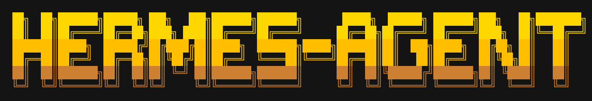
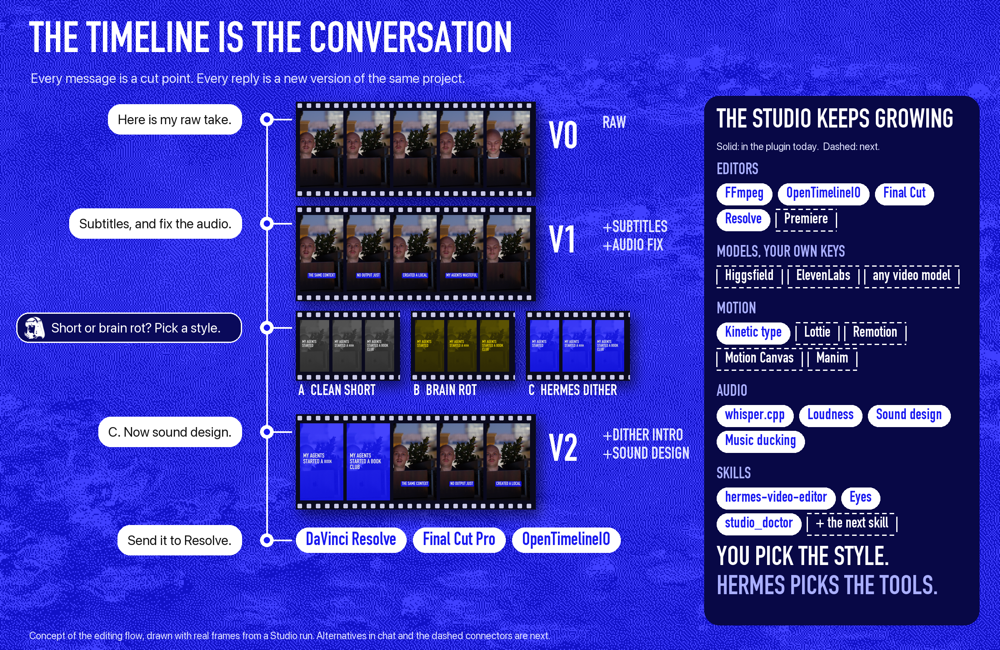
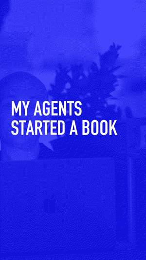
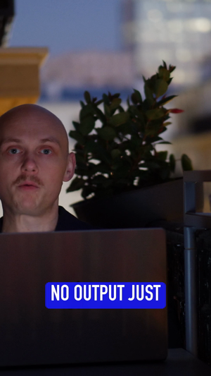
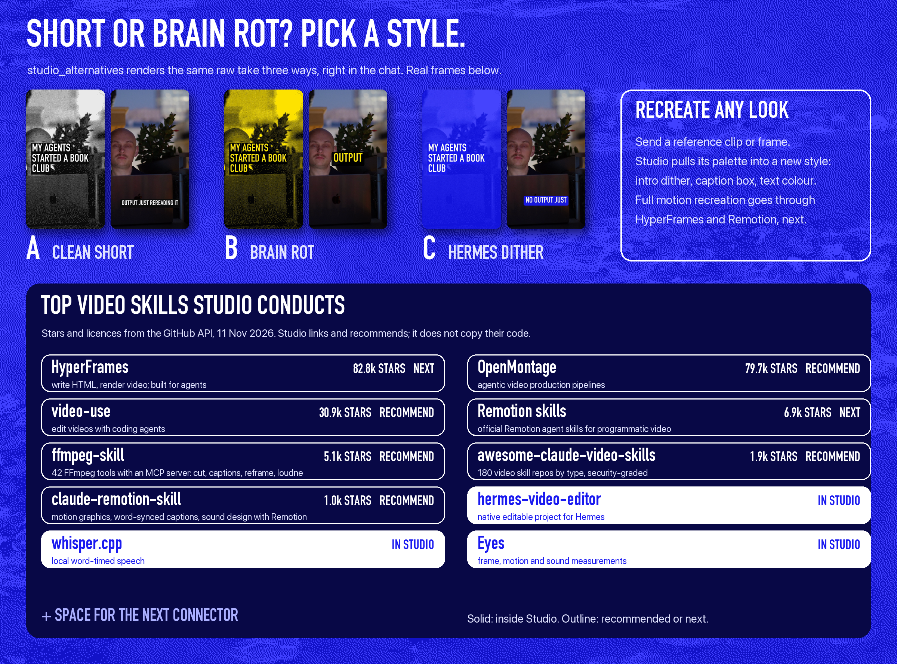

<p align="center">&nbsp;&nbsp;&nbsp;</p>

# Hermes Studio

### Video editing becomes a conversation.

Turn a reviewed local take into an editable vertical short with animated captions and music from your own library. Reply to the delivered preview to change it: Hermes finds the exact project behind that video and makes a new editable revision, which is rendered through an explicit safety gate.

Editing runs on your machine. Rendered previews and finished versions go to your own Hermes gateway and are sent to your Telegram chat. Nothing goes to a video-generation provider unless you approve a generated shot: then one reference frame goes to the provider you chose. Every version is kept, never overwritten.

## What is true today

| State | What |
|---|---|
| **Verified live** (Telegram, 11 Nov) | Raw footage sent to Pretzel: three style previews delivered; one picked and the full short delivered. |
| **Tested end to end, not yet run live** | Reply with several changes at once (`revise`); recreate a look from a reference clip; the editor's pick; karaoke captions; brain rot split screen; a music bed per style. Run through a fake Telegram in `test_hero_loop.py`. |
| **Local only** | `studio_finish`, `studio_alternatives`, `studio_demo` on the workstation. `studio_demo` needs no private footage and no paid service. |
| **Experimental** | Export to Final Cut and Resolve: FCPXML passes the schema shipped inside Final Cut Pro, cuts only, not yet imported through the app. OpenTimelineIO round trip, one video track. |
| **Not proven** | Any real paid generation (fal or Replicate adapter is tested against a fake provider only). |

**Two kinds of output, kept apart.** The conversation flow (`studio_finish`) gives a rendered MP4, an SRT and a re-runnable recipe (`finish.json`), not an editor timeline. The older reviewed-take flow (`studio_cut`, `studio_build`) gives a native editable `.vproj.json` project for hermes-video-editor.

<p align="center">
  
  
  
</p>
<p align="center"><sub>Live, 11 Nov 2026: reply "make the music quieter" to a preview. Hermes finds the matching project and queues a new revision.</sub></p>

## Try it in one command, no footage needed

```sh
python3 -m connectors.demo /tmp/studio-demo --model /path/to/ggml-model.bin   # --model is optional
```

It makes a sample clip with your system's own voice (`say` on macOS, `espeak` on Linux), then renders the three style previews and a finished short with subtitles, kinetic intro and sound design. No keys, no network, no private files. Without a speech model it uses the known script with even timing so the run still completes. In Hermes: `studio_demo`.

## Start here: `studio_doctor`

Ask Hermes for any video job ("make a Short from this", "add captions", "cut a trailer"). Hermes calls `studio_doctor` first: a read-only report of what your machine can do **now**, what **needs setup** and exactly how, what is **experimental**, and what is **unavailable**. It never installs, downloads or spends. On a fresh machine it is never all green, by design.

## Seen working


- **Reply to edit, live in Telegram (11 Nov 2026).** "Make the music quieter" on a delivered preview resolved the matching project and created a new editable revision with the music at -28 dB. That revision then waits at the render gate; the re-rendered video is not yet delivered automatically.
- **One reviewed take, end to end.** Local transcription, library music, an editable portrait cut with animated captions, and a checked export that passed frame, motion and audio measurements.
- **Local by design.** whisper.cpp on your machine, your own media library, no paid models.

**Today the conversation edit supports music level.** New, unmatched footage returns `needs_reviewed_cut_recipe` instead of guessing a story.

<br clear="right">

## The timeline is the conversation

<p align="center"></p>

The old timeline is a strip of clips you drag around. In Hermes Studio the timeline is the chat. Every message is a cut point, every reply is a new version of the same project recipe, and you can scroll back to any version.

**The take tree (tested with a fake Telegram, not run live).** Reply to any older video and the next version starts from that video, not from the newest one. Each caption names its version: V1, V2, and V2b for a second version made from V1. Send `tree` and Studio returns every version of the project as one image. Merging two versions into one is not built yet. `test_take_tree.py` covers it.

Hermes talks it through with you. Ask for a **Short** or full **brain rot**, and Hermes answers with alternatives right in the chat: a clean short, a brain-rot cut, the Hermes dither look. Pick one, keep directing. You pick the style; Hermes picks the tools.

Status: see the table at the top. Every claim there names its evidence.

## New: `studio_finish`, raw footage to a finished short

 

One call, all local:

- **Subtitles:** word-timed with whisper.cpp, 1 to 4 words at a time, with the word being spoken lit up karaoke-style. Also written as `captions.srt`.
- **Audio repair:** rumble cut, noise reduction, loudness to -14 LUFS.
- **Kinetic intro:** title words slam in over a blue-dithered first frame.
- **Sound design:** a whoosh into every title word, a sub hit on the cut into the footage.
- **Beat:** a music bed per style from your own shelf (set in the worker config, never picked by Studio), ducked under the voice. With a bed, "quieter music" is a real change.
- **Brain rot split screen:** the speaker on top, looping B-roll below, one huge word on the seam. Point the worker at your own clip, or Studio generates its own: a Game of Life in the style colours, moving dither with no rights questions.
- **Recipe:** `finish.json` records every choice, so the pass can be re-run with changes. It is a re-runnable recipe plus a rendered MP4 and SRT, not a native editor project. Earlier renders are never overwritten.
- **Mixed audio, said plainly:** if speech and music share one track, Studio cleans and levels the whole mix and says it cannot turn the original music down on its own. A new music bed is fully adjustable.

Run on a real 14-second raw camera take (Lumix, 18 Oct 2026): 6 subtitle chunks, finished in about 23 seconds on a laptop.

## Inspired by the ecosystem

There is a huge wave of video skills and engines. Studio wants to conduct them, not replace them:

- [hermes-video-editor](https://github.com/oliverhees/hermes-video-editor): the native editable project Studio builds on.
- [whisper.cpp](https://github.com/ggml-org/whisper.cpp): local word-timed speech.
- [Eyes](https://github.com/Agenziamaia/eyes): frame, motion and sound measurements.
- LottieFiles motion-design skill: motion timing and easing language.
- [Remotion](https://github.com/remotion-dev/remotion), [Motion Canvas](https://github.com/motion-canvas/motion-canvas), [Revideo](https://github.com/midrender/revideo), [Manim](https://github.com/ManimCommunity/manim): code-driven animation engines, next in line as motion connectors.
- Hermes showreel and session-recording hooks: turning agent work itself into footage.

## Styles, alternatives and the skills Studio conducts

<p align="center"></p>

- **`studio_alternatives`** renders the same raw take in several styles (clean short, brain rot, Hermes dither, mono kinetic) so Hermes can ask "Short or brain rot? Pick a style." in the chat. Each option is a real preview.
- **`studio_finish style=...`** finishes the full take in the style you picked.
- **Recreate a look, from the chat:** reply to your short with any reference video and "make it look like this". Studio pulls that clip's palette into a new style (dither pair, caption box, word highlight) and re-cuts your short in it as a new version. Full motion recreation is next, through HyperFrames and Remotion.
- **`studio_skills`** recommends the best skills in the ecosystem for a plain request ("animate my intro", "brain rot captions"), with repo, licence and whether Studio already does it. The list grows; every new skill is one entry.

## Direct it like an editor: several changes in one reply

Reply to a finished short the way you would talk to an editor: "keep C, use A's captions, tighten the opening, quieter music". Hermes sends one `revise` with all of it. Studio renders a new version, keeps the previous one, and answers with exactly what changed and what it could not do. Music mixed into the speech track cannot be lowered on its own, and Studio says so instead of pretending.

## Add any video model (fal or Replicate)

One adapter, many models. Put your own key on the workstation (`FAL_KEY` or `REPLICATE_API_TOKEN`), copy [`models.example.json`](models.example.json) to `~/.config/hermes-studio/models.json`, and fill in the model ids and prices from the provider's own model page. Then, in the chat:

1. Reply to a finished short: "add a 3-second animated blue intro".
2. Hermes answers with a quote: the model, the cost (or UNKNOWN if you did not set one), what you spent this month and your cap.
3. You reply **YES** plus the one-time code shown in the quote (for example `YES 7F3A2C`). Only then does Studio spend: it sends a frame of your footage as the reference, waits for the model, downloads the clip and puts it at the start of your short as a new version.

Keys never leave the workstation. Studio never guesses a price: a model without a declared per-call price is blocked. The monthly cap counts the prices you declare and is rechecked under a lock at the moment of spending, so two approvals cannot both slip under it. Studio cannot see or limit what the provider actually charges; check your provider dashboard. The approval is enforced on the workstation, not trusted to the agent: the one-time code exists only on the workstation and in your chat (never in the job the agent can read), expires after 30 minutes, works once, and is marked spent before any money moves. `test_approval.py` tries the attacks: a plain YES from the agent, a wrong code, a reused code, an expired quote. API shapes checked against the fal queue and Replicate predictions docs on 11 Nov 2026; tested end to end against a fake provider, not yet against a live paid call.

## Bring your own tools

Studio is the hub. Plug **any video model** into Hermes with your own account: your own **Higgsfield** (or any other video model) for generated shots, your own **ElevenLabs** for voice, sound effects and music, and your own editor (**Final Cut**, **DaVinci Resolve**, **Premiere**). Keys stay in your environment; Studio never stores or logs them. `studio_doctor` shows which ones are connected. Today these adapters are dry runs that plan the request; paid calls will always ask you first.

## The vision: one studio, every video tool

Every creative tool is getting an agent. None of them talk to each other. Hermes Studio is the conductor: one conversation, one shared timeline, every tool you already love.

You talk. Hermes picks the take, cuts it in your editor, animates it in your motion engine, generates the missing shot with the best model for the job, checks every frame, and hands you back an editable project. You stay the director. Hermes does the crew.

The connector layer is in this release (v0.6.0) as an early foundation. Every connector reports what it really preserves:

| Connector | Status | What survives |
|---|---|---|
| FFmpeg render | ✅ tested | cuts, portrait frame, audio |
| OpenTimelineIO | ✅ tested, read back by the real `opentimelineio` library | one video track of cuts. Captions, music and overlays are ❌ not carried yet |
| Final Cut Pro (FCPXML 1.10) | ✅ valid against the FCPXML schema that ships inside Final Cut Pro (a broken file fails the same check); not yet imported through the app | cuts only |
| DaVinci Resolve (FCPXML or OTIO) | ❓ not yet opened in Resolve | cuts only |
| Premiere Pro | ❌ next | |
| Higgsfield | ⚠️ dry run: plans a request, never sends, never spends | |
| Motion Canvas, Revideo, Manim | ❌ next | |

The goal is a loss report for every connector: what is preserved, what is flattened, what is not supported. Details: [docs/CONNECTORS.md](docs/CONNECTORS.md).

**Tests:** 110 run, 107 pass, 3 skipped because they need real media fixtures. The full suite renders real video and takes about 4 minutes: `python3 -m unittest discover -s . -p 'test_*.py'` (a short timeout cuts it off). It is not an end-to-end validation of the live Telegram loop.

### Next: one extraordinary edit, then the whole studio

Two reviews shaped this plan: the creator's ambition (every connector, every skill, any model) and Hermes' own critique (prove one complete creative outcome first). They fit together:

1. **The hero moment, now wired (v0.7.0).** Send fresh raw footage in Telegram: Hermes queues `alternatives`, the workstation renders A clean short, B brain rot and C Hermes dither and sends each as its own message. After the previews, Studio gives its own pick and why, from what it can measure (pace, how early the first words land). Reply with a letter: `finish` sends back the full finished short in that style. Reply with another letter: a re-cut from the same source. `test_hero_loop.py` runs this whole loop against a fake Telegram. Next: the same loop live on the gateway.
2. **One real generated insert.** One provider on the user's own key, one generated shot placed in the edit, cost shown and approved first.
3. **Reproducible by anyone.** A sample project with redistributable media and a one-command run, checked by `studio_doctor`.
4. **Then grow without limits.** Each new connector or skill is one adapter or one registry entry, and it reports what it preserves.

## Install

The full plugin requires Hermes >=0.21.5. The verified composed session used Hermes0.22.7. Install the separately licensed editor, FFmpeg/ffprobe with drawtext/loudnorm/libx264/AAC, and an existing local speech model first. Studio never downloads a model. Local editing never calls a paid provider; the only paid path is a generated shot you approve with YES plus a one-time code.

```sh
hermes plugins install Morkeeth/hermes-studio --enable
hermes plugins install oliverhees/hermes-video-editor --ref 66035165c71e09b7f77a08aecc36e35c0b2dce14 --enable
```

Validate the exact checked-out source and inspect registration before use:

```sh
hermes plugins validate /path/to/hermes-studio
hermes plugins doctor /path/to/hermes-studio --ci
python3 -m unittest discover -s /path/to/hermes-studio -p 'test_*.py' -v
```

Core tools: studio_take, studio_library, studio_build, studio_cut, studio_gate, studio_verify_post, studio_request, studio_status, studio_connectors, studio_timeline, studio_generate, studio_doctor, studio_finish, studio_alternatives, studio_skills, studio_demo. Read [SKILL.md](SKILL.md) for the explicit reviewed-recipe requirements. studio_build accepts recipe, output and render=false by default. A genuine native project template and actual word alignment are required inputs. New footage is not silently given invented timing or story approval.

## Two-host conversation flow

The gateway-only companion in [gateway/](gateway/) requires Hermes >=0.20.0 and exposes only studio_request/studio_status plus the channel-flow skill. Do not install both companions on the same host because their tool names overlap. Use the full plugin on the workstation and the small companion on a gateway. The old gateway runtime does not imply support for the full editor.

Create private gateway configuration at HERMES_HOME/studio-channel/config.json from [GATEWAY.example.json](GATEWAY.example.json). Set real inbound roots and a confirmed allowed recipient. The host launcher supplies the existing single-profile environment; delivery resolves TELEGRAM_BOT_TOKEN only through Hermes agent.secret_scope.get_secret. The plugin never reads a credential file. The token is never copied to the workstation or repo. Enable the gateway companion through the official plugin installer using its repository subdirectory URL, then enable its name. Load hermes-studio-bridge:channel-flow explicitly; plugin skills may be absent from the flat available-skills index.

Create a private workstation config from [WORKER.example.json](WORKER.example.json). The workstation initiates outbound SSH using an existing alias; no public listener or reverse login is required. Point remote_rpc at bridge_rpc.py and use a fresh workspace. Run one bounded pass:

```sh
python3 connector_worker.py --config /private/workstation.json
```

Add --deliver-ready only when sending checked previews to the configured recipient is authorized. No daemon or scheduler is installed automatically. Supply a stable request_key based on the real channel/chat/message for retries. library searches the configured workstation folders; prepare transfers the actual downloaded attachment with hash verification. A configured reviewed project can be reused only for the exact original source. Unmatched footage returns needs_reviewed_cut_recipe.

An explicit music_gain_db edit creates a native project successor, preserves old versions and invalidates the old preview. It waits for the existing render gate; no new encode is launched. Delivery receipts distinguish started/uncertain from Telegram-confirmed sent. Unknown outcomes are not automatically retried. API acceptance does not prove phone playback.

## Boundaries

No paid generation, automatic public publication, arbitrary remote commands, inferred music rights, semantic library retrieval, face tracking or automatic taste certification. No broad editing autonomy is granted by these tools. studio_gate combines measurements with supplied title/caption/no-zoom observations; missing or stale visual review fails. Keep story/look decisions separate. Render authorization, source immutability, external uploads and spending remain host/operator policy.

This is a single-owner template. The queue is not a public multi-user service. Advanced arbitrary reply edits, a complete new-footage judgement loop, continuous worker supervision, additional editor adapters and a generative-model hub remain future work. Editing state is a real native .vproj.json, not chat prose.

## Credits and licenses

Studio code: MIT. The manifest format follows oliverhees/hermes-video-editor/plugin.yaml at the pin above. That separate editor uses PolyForm Noncommercial1.0.0 and is not redistributed; commercial use may require separate permission.

- [whisper.cpp](https://github.com/ggml-org/whisper.cpp) — MIT, local ASR backend.
- [hermes-video-editor](https://github.com/oliverhees/hermes-video-editor) — native editable project and media tools; separate dependency/license.
- [Eyes](https://github.com/Agenziamaia/eyes) — MIT, optional measurements/contact sheet; no semantic approval claim.
- [Hermes Showreel](https://github.com/Duffey234/hermes-showreel) — MIT, optional actual session hooks/planning; narration disabled for unpaid operation.
- [LottieFiles motion-design-skill](https://github.com/LottieFiles/motion-design-skill) — MIT guidance used for demo timing, not a bundled renderer.

No media, models, proprietary fonts, external plugin source, private host configuration, credentials or private repository history are distributed. FFmpeg builds carry their own terms and are not bundled. Prepared for the Hermes Agent Plugin Hackathon; this repository is not evidence of event submission.

For standalone SSH delivery, configure remote_prefix as an operator-owned host launcher that supplies the existing profile environment (for example a systemd transient service with an EnvironmentFile). Hermes secret_scope resolves the token; plugin code never opens a credential store. Keep launcher paths and all real host configuration private. With multiplexing, provide the correct secret scope or fail closed.

## Recipe configuration

Copy RECIPE.example.json to private storage and replace every path/hash with actual local inputs. The reviewed native project must initially reference only the exact original camera take. The alignment file contains the actual words array used for that source (each word includes text and measured start/end anchors). Fresh ASR/hook suggestions are recorded separately; they do not overwrite reviewed timing. Record the real shelf track rights/scope. The build fails when source/template/music hashes differ or no local track matches.

Call studio_build with recipe set to that private JSON, output set to a fresh absent directory, render=false. Inspect the saved project before any authorized render=true invocation. No example asset or configuration is evidence of a completed film.
